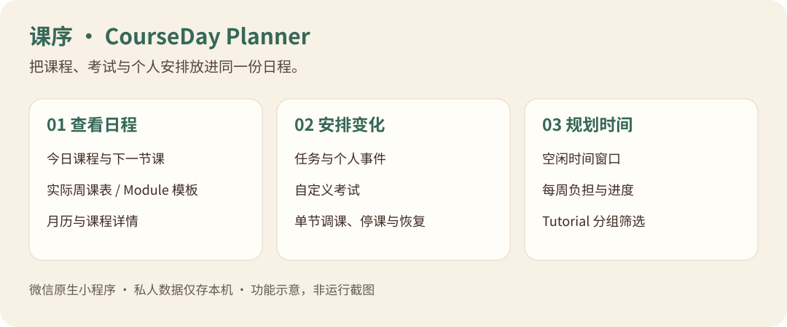

# M Plan · 课时记

把课程、考试、任务和个人日程放进同一份时间表。课时记是一款微信原生的本地课表工具，适合需要在周课表与月历之间切换、处理临时调课并寻找空闲时间的用户。

**功能版本：V2.1.7 · 13 个页面 · 私人数据仅存本机 · MIT 开源**



> 上图为功能示意，不是真机截图。项目面向不同学校、专业和年级；随包示例是一组可替换的课程选集，不代表任何学校的全校课表。

## 可以做什么

| 场景 | 功能 |
| --- | --- |
| 今天上什么课 | 今日课程、下一节课、课程详情、Module 进度与每周负担 |
| 查看一周或整月 | 实际周、Module 模板、月历和考试中心 |
| 安排自己的事 | 本地任务增删改查；单次、连续多日或离散日期的个人事件 |
| 考试和课程有变化 | 添加自定义考试；调整单节课程的日期、时间、地点或停课；删除调整恢复原课表 |
| 找到空闲时间 | 结合确定课程、考试与个人安排计算空闲窗口 |
| 选择 Tutorial | 按分组筛选；未确认候选窗口可见，但不占用空闲时间 |

通过微信右上角原生分享发送通用入口；设置页支持确认后清空本机个人数据。

## 使用流程


公共课表静态保存在源码中，个人修改和设置保存在微信 Storage。临时调整不会覆盖公共课表；项目保持 V2.1.7 的纯本地架构，无服务器、账号或跨设备同步。

## 快速开始

1. 克隆仓库，在微信开发者工具导入包含 `project.config.json` 的根目录。
2. `miniprogramRoot` 为 `miniprogram/`；公开配置始终保留 `touristappid`。
3. 真机调试需在本地配置合法 AppID，勿将其提交。提交前运行隐私检查。
4. 示例日期属于 2026–27 学年，使用前核实或替换为自己的课表。

## 回归与打包

需要 Python 3.10+、Node.js 22+。只有重建 Excel 数据时需要 `python -m pip install -r requirements-dev.txt`。

```sh
python tools/validate_schedule.py
node tools/smoke_test.js
node tools/privacy_test.js
python tools/prepublish_check.py
python tools/workflow.py all
```

全量工作流运行回归、页面结构、语法与隐私检查，生成 `release/` 下 ZIP、SHA-256 与包内清单。GitHub Actions 只运行离线测试，无部署或上传密钥。

## 版本基线

保留 13 个页面、163 条静态事件、99 次 Lecture、8 次 Final、12 个精确分组 Tutorial 和 21 个 `nonBlocking` Tutorial 候选窗口。保留原事件 ID、日期、时间及所有原版功能，不合入 V2.1.8。

`source/sample-timetable-2026-27.xlsx` 是去标识的项目整理示例，`tools/build_schedule.py` 可重建事件。原上传资料、官方 PDF、个人记录与私人截图不在公开包内。

## 数据与隐私

保留 `maa_v2_tasks`、`maa_v2_personal_events`、`maa_v2_custom_exams`、`maa_v2_reschedules`、`maa_v2_settings`，改名不清空旧数据。静态课表不会被个人修改覆盖。详见 `DESIGN.md` 与 `PRIVACY_AND_DATA.md`。

## 参与贡献

欢迎通过 Issue 提交问题，或通过 Pull Request 改进项目。开发约定见 [CONTRIBUTING.md](CONTRIBUTING.md) 和 [AGENTS.md](AGENTS.md)。请使用虚构数据复现问题，避免提交私人记录、备份或真实 AppID。

## 许可与后续方向

代码使用 [MIT License](LICENSE)。数据与隐私边界见 [PRIVACY_AND_DATA.md](PRIVACY_AND_DATA.md)，人工验收项见 [QA_REPORT.md](QA_REPORT.md)。

示例课程的来源与再分发说明见 [source/README.md](source/README.md)。后续优先完善课表导入格式、小屏布局与本地回归覆盖，保持纯本地架构。
